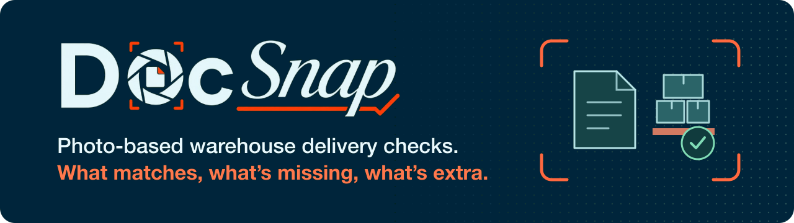

<p align="center">
  
</p>

<h1 align="center">DocSnap</h1>

<p align="center"><strong>Foto. Match. Hotovo.</strong></p>

<p align="center">
  <a href="https://docsnap-gymbeam.lovable.app/"></a>
  
  
  
</p>

DocSnap is a mobile-first warehouse receiving prototype. Take a photo of the delivery note and one or more photos of the pallet. DocSnap compares the expected quantities with what it can identify in the photos and highlights discrepancies for the person receiving the delivery.

## Try it in a minute

1. Open the [hosted demo](https://docsnap-gymbeam.lovable.app/).
2. Select **Vyskúšaj s ukážkovými dátami** on the capture screen to load the sample delivery.
3. Select **Iba problémy** in the match report to show only discrepancies. Tap a row to see the item and its counts.

The sample delivery includes all four outcomes. Here are four rows from the fixture:

| Item | Expected | Detected | Result |
| --- | ---: | ---: | --- |
| Chocolate whey | 12 | 12 | Match |
| Vanilla whey | 8 | 6 | Short by 2 |
| Watermelon BCAA | 6 | 0 | Missing |
| Black shaker | 50 | 52 | 2 extra |

## From photos to a match report

1. **Read the delivery note.** Extract product names, SKUs, units, and expected counts.
2. **Inspect the pallet.** Use the expected items to identify visible products in each photo and estimate quantities.
3. **Review the differences.** Compare expected and detected quantities by SKU. Open a row to inspect its counts and confidence.

The model estimates quantities from what it can see, so check discrepancies against the physical delivery. The receiving and discrepancy-reporting buttons show demo confirmations. Results live in the current browser session and reset on reload.

## Run locally

Install [Bun](https://bun.com/docs/installation), then run:

```sh
git clone https://github.com/YuriiMurha/docsnap.git
cd docsnap
bun install --frozen-lockfile
bun run dev
```

Open the local URL printed by Vite. The sample-data button works without credentials. Photo submissions also return sample results when no API key is configured.

### Use your own photos

Set `OPENROUTER_API_KEY` in the server environment before starting the app. Optionally set `OPENROUTER_MODEL` to select another vision-capable model. With a key configured, the server sends the submitted images to OpenRouter for analysis.

## Built with

- **React, TypeScript, and Tailwind CSS** for the mobile capture and review screens.
- **TanStack Start** for routing and the server functions that process images.
- **OpenRouter** for vision inference and **Cloudflare Workers** as the configured build target.

[Sample delivery note](public/demo/lieferschein-sample.svg) · [Sample pallet](public/demo/pallet-sample.svg)
